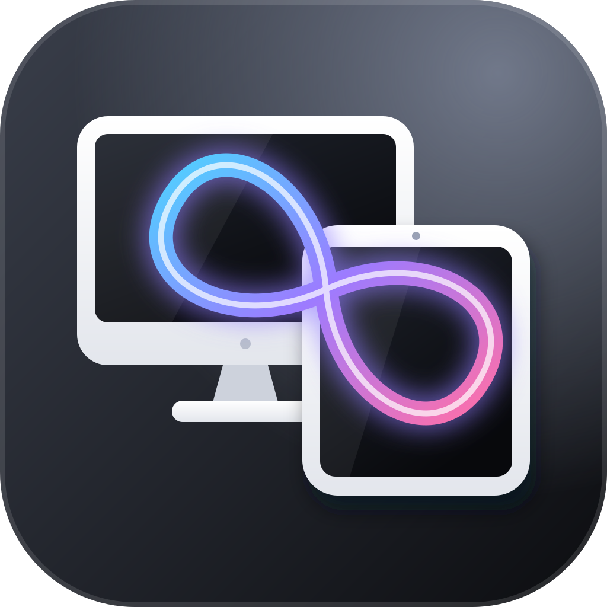
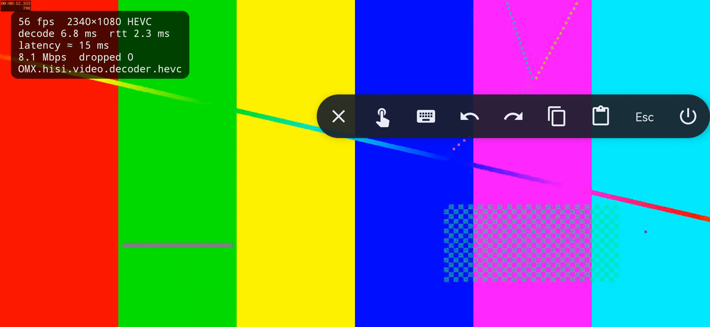
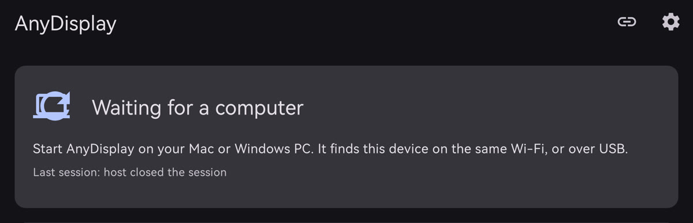
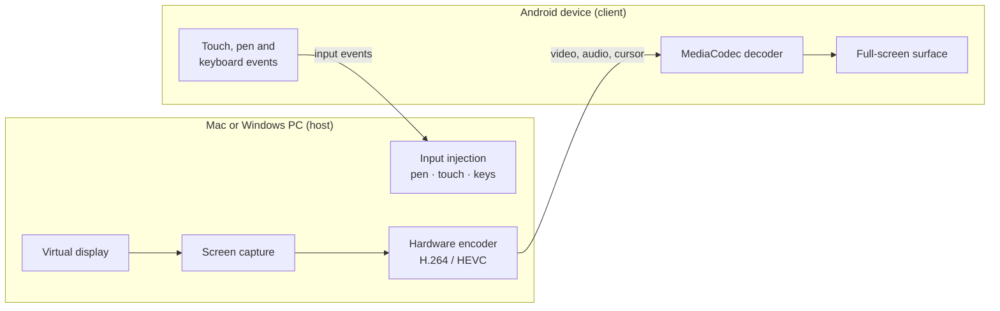

<div align="center">



# AnyDisplay

**Turn any Android phone or tablet into a second monitor, touch screen and pen tablet for your Mac or Windows PC.**

USB or Wi-Fi · hardware H.264 / HEVC · pressure-sensitive pen · encrypted pairing · open protocol

[](https://github.com/efekurucay/anydisplay/actions/workflows/ci.yml)
[](https://github.com/efekurucay/anydisplay/releases/latest)
[](LICENSE)




</div>

---

Closed-source apps such as SuperDisplay, Duet Display and spacedesk already turn a tablet into a
second screen. Most of them support only one desktop OS and keep their protocol private.
AnyDisplay is a free, MIT-licensed alternative:

- **One Android app** works with both a **Mac** and a **Windows PC**.
- **A real extended display**, not a mirror. On macOS AnyDisplay creates a virtual monitor of the
  device's resolution, so you can drag windows onto it.
- **[Open, documented protocol](docs/PROTOCOL.md)** with a Python reference implementation and
  test vectors, so anyone can write a client or a host for another platform.

## Features

| | |
|---|---|
| 🖥️ **Display** | Extended or mirrored desktop, HiDPI (Retina) on macOS, up to 120 Hz, follows device rotation |
| 🎞️ **Video** | Hardware H.264 and HEVC on both ends, low-latency encoder and decoder settings, at most 3 frames in flight, keyframe on request |
| ✍️ **Pen** | Pressure, tilt, hover, eraser and barrel button. Batched samples keep strokes smooth |
| 👆 **Touch** | Direct multi-touch (up to 10 fingers on Windows), trackpad mode with tap, drag, two-finger scroll and momentum, pen-only mode, palm rejection |
| ⌨️ **Keyboard** | Hardware keyboards and the on-screen keyboard, including non-Latin text. Toolbar shortcuts for undo, redo, copy, paste and Esc |
| 🔊 **Audio** | Computer audio plays on the device |
| 🖱️ **Cursor** | Drawn on the device as a separate layer, so it stays sharp and responsive |
| 📋 **Clipboard** | Text clipboard sync in both directions |
| 🔒 **Security** | P-256 key exchange, a 6-digit code to compare when pairing, AES-256-GCM on every Wi-Fi frame |
| 📡 **Discovery** | Finds devices with Bonjour / mDNS on Wi-Fi and with `adb` on USB |

## Performance

Measured on a Huawei P30 Pro (2340×1080, HiSilicon HEVC decoder) with a MacBook Pro host:

| Link | Frame rate | Dropped frames | Decode time | Round trip |
|---|---|---|---|---|
| USB (`adb forward`) | 60 fps | 0 | 5–7 ms | ~3 ms |
| Wi-Fi, encrypted | 60 fps | 0 | 5–8 ms | 7–20 ms |



## How it works



1. The Android app listens on TCP port 47820 and announces itself over mDNS (`_anydisplay._tcp`).
   Over USB, the host reaches the same port through `adb forward`.
2. The host connects. Both sides do an ECDH key exchange. The first Wi-Fi connection asks you to
   confirm a 6-digit code on both screens; later connections use the stored pairing secret.
3. The host creates the virtual display, captures it, encodes it in hardware and streams it.
   Input travels back on its own channel, so a big video frame never delays a pen stroke.

The full wire format, handshake and key schedule are in [`docs/PROTOCOL.md`](docs/PROTOCOL.md).

## Download

| Download | For |
|---|---|
| [**AnyDisplay.apk**](https://github.com/efekurucay/anydisplay/releases/latest/download/AnyDisplay.apk) | The Android phone or tablet (Android 8.0+) |
| [**AnyDisplay-macOS.zip**](https://github.com/efekurucay/anydisplay/releases/latest/download/AnyDisplay-macOS.zip) | Mac (Apple silicon and Intel, macOS 14+) |
| [**AnyDisplay-windows-x64.zip**](https://github.com/efekurucay/anydisplay/releases/latest/download/AnyDisplay-windows-x64.zip) | Windows 10 (1809) / 11, experimental |

These links always serve the newest version. Checksums and older versions are on the
[releases page](https://github.com/efekurucay/anydisplay/releases).

1. **Android:** open the APK on the device and allow installing from that source. For USB, also
   turn on **USB debugging** in the developer options.
2. **Mac:** unzip and move **AnyDisplay.app** to Applications. The app is not notarized yet, so
   macOS blocks the first launch: open it once, then choose *System Settings → Privacy & Security →
   Open Anyway*. Or run `xattr -dr com.apple.quarantine /Applications/AnyDisplay.app`.
   AnyDisplay lives in the menu bar.
3. **Windows:** unzip and run `anydisplay-win.exe list`, then `anydisplay-win.exe usb` or
   `anydisplay-win.exe connect <device IP>` from a terminal. See [`windows/README.md`](windows/README.md).

Open the app on the device, then connect from the computer. The first Wi-Fi connection shows the
same 6-digit code on both screens; accept it on both.

## Build from source

### 1. Android app

Requires Android 8.0 or newer.

```sh
cd android
./gradlew assembleDebug
adb install -r app/build/outputs/apk/debug/app-debug.apk
```

Open **AnyDisplay** on the device. For USB, enable **USB debugging** in the developer options.

### 2a. Mac host

Requires macOS 14 or newer and Swift 6.

```sh
cd macos
scripts/bundle.sh                         # builds build/AnyDisplay.app, a menu bar app
open build/AnyDisplay.app
```

Or use the command line:

```sh
swift run anydisplay discover             # list devices on Wi-Fi and USB
swift run anydisplay usb                  # connect over USB
swift run anydisplay connect 192.168.1.20 # connect over Wi-Fi; the first time, compare the code
```

Grant **Screen Recording** (for the display) and **Accessibility** (for touch, pen and keyboard)
in *System Settings → Privacy & Security* when asked.

### 2b. Windows host

Requires Windows 10 (1809) or newer and Rust. Install the open-source
[Virtual Display Driver](https://github.com/VirtualDrivers/Virtual-Display-Driver) to get an
extended display; without it, AnyDisplay mirrors a monitor.

```powershell
cd windows
cargo build --release
target\release\anydisplay-win.exe list
target\release\anydisplay-win.exe usb
```

See [`windows/README.md`](windows/README.md) for options and driver setup.

## Project layout

| Path | What | Stack |
|---|---|---|
| [`android/`](android) | Client app | Kotlin, MediaCodec, Material 3 |
| [`macos/`](macos) | Mac host: CLI and menu bar app | Swift, CGVirtualDisplay, ScreenCaptureKit, VideoToolbox |
| [`windows/`](windows) | Windows host | Rust, DXGI Desktop Duplication, Media Foundation, synthetic pointer input, WASAPI |
| [`docs/PROTOCOL.md`](docs/PROTOCOL.md) | AnyDisplay Protocol v1 | |
| [`tools/anydisplay_ref.py`](tools/anydisplay_ref.py) | Reference host and client, test vector generator | Python, `cryptography`, ffmpeg |

## Testing

```sh
(cd macos && swift test)
(cd windows && cargo test)
(cd android && ./gradlew testDebugUnitTest)

python3 -m venv tools/.venv && tools/.venv/bin/pip install cryptography
tools/.venv/bin/python tools/anydisplay_ref.py vectors | diff - tools/vectors.json
```

All three implementations check themselves against `tools/vectors.json`. The reference tool can
also stand in for either side of a live session:

```sh
tools/.venv/bin/python tools/anydisplay_ref.py host 127.0.0.1:47820   # streams an ffmpeg test pattern to a device
tools/.venv/bin/python tools/anydisplay_ref.py client                 # acts as a device for a host under test
```

## Status

AnyDisplay is young. What has been tested:

- **Android client ↔ Mac host:** tested end to end on real hardware (Huawei P30 Pro, MacBook Pro)
  over USB and Wi-Fi: pairing, encryption, video and touch. Audio, cursor and clipboard were each
  verified against the reference implementation.
- **Windows host:** builds and passes its unit and protocol tests on a Windows CI runner, but has
  not been tried with a real device yet. Reports are very welcome.
- **Pen input:** verified with on-device tests that use synthetic stylus events. It still needs a
  test with a real stylus device.
- **USB accessory (AOAP) transport:** implemented but untested.

## Roadmap

- Notarized macOS app and a Windows installer
- Google Play and F-Droid listings
- Linux host
- Several devices connected to one computer at the same time
- iPad client

## Contributing

Issues and pull requests are welcome. See [CONTRIBUTING.md](CONTRIBUTING.md). Any change to the
protocol must update `docs/PROTOCOL.md`, the reference implementation and `tools/vectors.json`
together.

## License

[MIT](LICENSE)
