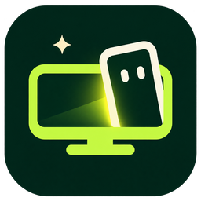
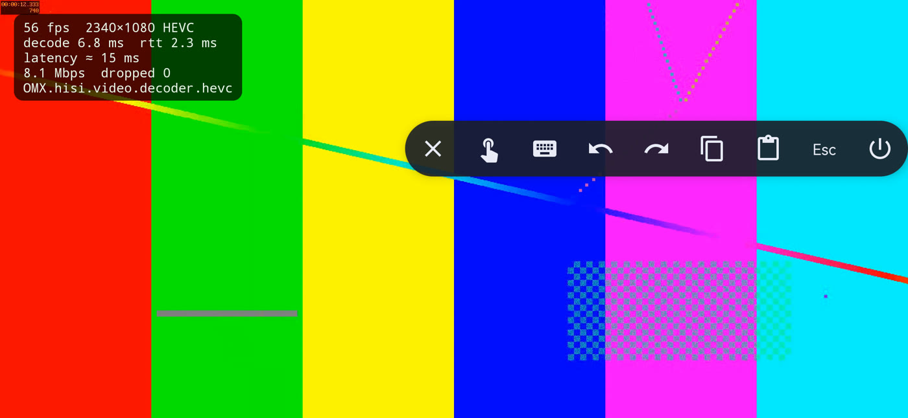
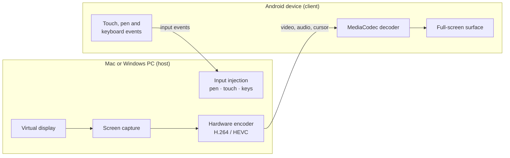

<div align="center">



# Use That Screen

**Turn any Android phone or tablet into a second monitor, touch screen and pen tablet for your Mac or Windows PC.**

USB or Wi-Fi · hardware H.264 / HEVC · pressure-sensitive pen · encrypted pairing · open protocol

[](https://github.com/efekurucay/usethatscreen/actions/workflows/ci.yml)
[](https://github.com/efekurucay/usethatscreen/releases/latest)
[](LICENSE)




</div>

---

Closed-source apps such as SuperDisplay, Duet Display and spacedesk already turn a tablet into a
second screen. Most of them support only one desktop OS and keep their protocol private.
Use That Screen is a free, MIT-licensed alternative:

- **One Android app** works with both a **Mac** and a **Windows PC**.
- **A real extended display**, not a mirror. On macOS Use That Screen creates a virtual monitor of the
  device's resolution, so you can drag windows onto it.
- **[Open, documented protocol](docs/PROTOCOL.md)** with a Python reference implementation and
  test vectors, so anyone can write a client or a host for another platform.

[**Website & setup guide →**](https://usethatscreen.com/)

## Features

| | |
|---|---|
| 🖥️ **Display** | Extended or mirrored desktop, view-only window sharing on macOS, HiDPI (Retina) on macOS, up to 120 Hz, follows device rotation |
| 🎞️ **Video** | Hardware H.264 and HEVC on both ends, low-latency encoder and decoder settings, at most 3 frames in flight, keyframe on request |
| ✍️ **Pen** | Pressure, tilt, hover, eraser and barrel button. Batched samples keep strokes smooth |
| 👆 **Touch** | Direct multi-touch (up to 10 fingers on Windows), trackpad mode with tap, drag, two-finger scroll and momentum, pen-only mode, palm rejection |
| ⌨️ **Keyboard** | Hardware keyboards and the on-screen keyboard, including non-Latin text. Toolbar shortcuts for undo, redo, copy, paste and Esc |
| 🔊 **Audio** | Computer audio plays on the device |
| 🖱️ **Mouse** | Client-rendered cursor, hardware scroll, and Back and Forward buttons on supported mice |
| 📋 **Clipboard** | Text clipboard sync in both directions |
| 🔒 **Security** | P-256 key exchange, a 6-digit code to compare when pairing, AES-256-GCM on every Wi-Fi frame |
| 📡 **Discovery** | Finds devices with Bonjour / mDNS on Wi-Fi and with `adb` on USB |

## Performance

Measured on a Huawei P30 Pro (2340×1080, HiSilicon HEVC decoder) with a MacBook Pro host:

| Link | Frame rate | Dropped frames | Decode time | Round trip |
|---|---|---|---|---|
| USB (`adb forward`) | 60 fps | 0 | 5–7 ms | ~3 ms |
| Wi-Fi, encrypted | 60 fps | 0 | 5–8 ms | 7–20 ms |

## How it works



1. The Android app listens on TCP port 47820 and announces itself over mDNS (`_usethatscreen._tcp`).
   Over USB, the host reaches the same port through `adb forward`.
2. The host connects. Both sides do an ECDH key exchange. The first Wi-Fi connection asks you to
   confirm a 6-digit code on both screens; later connections use the stored pairing secret.
3. The host creates the virtual display, captures it, encodes it in hardware and streams it.
   Input travels back on its own channel, so a big video frame never delays a pen stroke.

During a stream, open the floating menu and tap **±** to pinch to zoom or drag to pan locally.
Tap **±** again to resume sending touch input to the computer at the current zoom, or **1×** to fit
the full display. For Android-initiated Wi-Fi sessions on Windows, see the [Windows guide](windows/README.md#connect-from-android).

The full wire format, handshake and key schedule are in [`docs/PROTOCOL.md`](docs/PROTOCOL.md).

A build-from-source [iPad client](ipad/README.md) can view an extended or mirrored desktop over Wi-Fi.

## Download

| Download | For |
|---|---|
| [**UseThatScreen.apk**](https://github.com/efekurucay/usethatscreen/releases/latest/download/UseThatScreen.apk) | The Android phone or tablet (Android 7.1+) |
| [**UseThatScreen-macOS.zip**](https://github.com/efekurucay/usethatscreen/releases/latest/download/UseThatScreen-macOS.zip) | Mac (Apple silicon and Intel, macOS 14+) |
| [**Use That Screen Windows setup**](https://github.com/efekurucay/usethatscreen/releases/latest/download/UseThatScreen-windows-x64-setup.exe) ([portable ZIP](https://github.com/efekurucay/usethatscreen/releases/latest/download/UseThatScreen-windows-x64.zip)) | Windows 10 (1809) / 11, experimental |

These links always serve the newest version. Checksums and older versions are on the
[releases page](https://github.com/efekurucay/usethatscreen/releases).

For a guided first connection and common fixes, see the [setup guide](docs/SETUP.md).
USB requires [Android SDK Platform-Tools](https://developer.android.com/tools/releases/platform-tools)
on the computer and a data-capable USB cable.

1. **Android:** open the APK on the device and allow installing from that source. For USB, also
   turn on **USB debugging** in the developer options.
2. **Mac:** unzip and move **Use That Screen.app** to Applications. The app is not notarized yet, so
   macOS blocks the first launch: open it once, then choose *System Settings → Privacy & Security →
   Open Anyway*. Or run `xattr -dr com.apple.quarantine "/Applications/Use That Screen.app"`.
   Use That Screen lives in the menu bar.
3. **Windows:** run the setup and open **Use That Screen** from the Start menu. With the portable ZIP,
   extract it and run `usethatscreen-gui.exe`. See the [Windows guide](windows/README.md) for
   extended display setup and command-line usage.

Open the app on the device, then connect from the computer. The first Wi-Fi connection shows the
same 6-digit code on both screens; accept it on both.

## Build from source

### 1. Android app

Requires Android 7.1 or newer.

```sh
cd android
./gradlew assembleDebug
adb install -r app/build/outputs/apk/debug/app-debug.apk
```

Open **Use That Screen** on the device. For USB, enable **USB debugging** in the developer options.

### 2a. Mac host

Requires macOS 14 or newer and Swift 6.

```sh
cd macos
scripts/bundle.sh                         # builds build/Use That Screen.app, a menu bar app
open "build/Use That Screen.app"
```

Or use the command line:

```sh
swift run usethatscreen discover             # list devices on Wi-Fi and USB
swift run usethatscreen usb                  # connect over USB
swift run usethatscreen connect 192.168.1.20 # connect over Wi-Fi; the first time, compare the code
```

Grant **Screen Recording** (for the display) and **Accessibility** (for touch, pen and keyboard)
in *System Settings → Privacy & Security* when asked.

### 2b. Windows host

Requires Windows 10 (1809) or newer and Rust. Install the open-source
[Virtual Display Driver](https://github.com/VirtualDrivers/Virtual-Display-Driver) to get an
extended display; without it, Use That Screen mirrors a monitor.

```powershell
cd windows
cargo build --release
target\release\usethatscreen-gui.exe         # system tray GUI app
target\release\usethatscreen-win.exe list    # or use the CLI
target\release\usethatscreen-win.exe usb
```

See [`windows/README.md`](windows/README.md) for options and driver setup.

## Project layout

| Path | What | Stack |
|---|---|---|
| [`android/`](android) | Client app | Kotlin, MediaCodec, Material 3 |
| [`macos/`](macos) | Mac host: CLI and menu bar app | Swift, CGVirtualDisplay, ScreenCaptureKit, VideoToolbox |
| [`windows/`](windows) | Windows host: CLI and GUI/tray app | Rust, egui, DXGI Desktop Duplication, Media Foundation, synthetic pointer input, WASAPI |
| [`docs/PROTOCOL.md`](docs/PROTOCOL.md) | Use That Screen Protocol v1 | |
| [`tools/usethatscreen_ref.py`](tools/usethatscreen_ref.py) | Reference host and client, test vector generator | Python, `cryptography`, ffmpeg |

## Testing

```sh
(cd macos && swift test)
(cd windows && cargo test)
(cd android && ./gradlew testDebugUnitTest)

python3 -m venv tools/.venv && tools/.venv/bin/pip install cryptography
tools/.venv/bin/python tools/usethatscreen_ref.py vectors | diff - tools/vectors.json
```

All three implementations check themselves against `tools/vectors.json`. The reference tool can
also stand in for either side of a live session:

```sh
tools/.venv/bin/python tools/usethatscreen_ref.py host 127.0.0.1:47820   # streams an ffmpeg test pattern to a device
tools/.venv/bin/python tools/usethatscreen_ref.py client                 # acts as a device for a host under test
```

## Status

Use That Screen is young. What has been tested:

- **Android client ↔ Mac host:** tested end to end on real hardware (Huawei P30 Pro, MacBook Pro)
  over USB and Wi-Fi: pairing, encryption, video and touch. Audio, cursor and clipboard were each
  verified against the reference implementation.
- **Windows host:** a community report confirms USB connection, handshake and hardware HEVC
  streaming at 2200×1440 on a TCL NXTPAPER 11 Plus (Android 15). Other Windows features still
  need device testing. See [PR #3](https://github.com/efekurucay/usethatscreen/pull/3).
- **Pen input:** verified with on-device tests that use synthetic stylus events. It still needs a
  test with a real stylus device.
- **USB accessory (AOAP) transport:** implemented but untested.

## Tested devices

These are specific test reports, not a guarantee for every feature or device.

| Android device | Host | Verified | Source |
|---|---|---|---|
| Huawei P30 Pro | MacBook Pro | USB and Wi-Fi video, pairing and touch; 60 fps at 2340×1080 | Maintainer testing; measurements above |
| TCL NXTPAPER 11 Plus (9469X), Android 15 | Windows 11 | USB discovery with an empty serial, handshake, hardware HEVC stream at 2200×1440 | [@dionisvl, PR #3](https://github.com/efekurucay/usethatscreen/pull/3) |
| Xiaomi Redmi Note 12 Pro, Android 14 (HyperOS 2.0.16.0) | Mac mini M4, macOS Tahoe 26.6.2 (25G83) | USB and Wi-Fi connection at 1080×2400, with 56–60 fps over USB (ADB) and about 40–58 fps over Wi-Fi | [@motionkartik, issue #6](https://github.com/efekurucay/usethatscreen/issues/6) |
| Amazon Fire TV Stick 4K Max (2nd generation) | Windows 11 Home 26H2 | Wi-Fi mirroring at 1920×1080, 60 Hz, hardware HEVC | [@dionisvl, issue #16](https://github.com/efekurucay/usethatscreen/issues/16) |

Tried another device? [Send a device report](https://github.com/efekurucay/usethatscreen/issues/new?template=device_report.yml).
Real stylus pressure/tilt, Windows touch, audio and clipboard need more hardware reports.

## Roadmap

- Notarized macOS app and a Windows installer
- Google Play and F-Droid listings
- Linux host
- Several devices connected to one computer at the same time
- iPad client

## Contributing

Issues and pull requests are welcome. See [CONTRIBUTING.md](CONTRIBUTING.md). Any change to the
protocol must update `docs/PROTOCOL.md`, the reference implementation and `tools/vectors.json`
together.

## License

[MIT](LICENSE)
